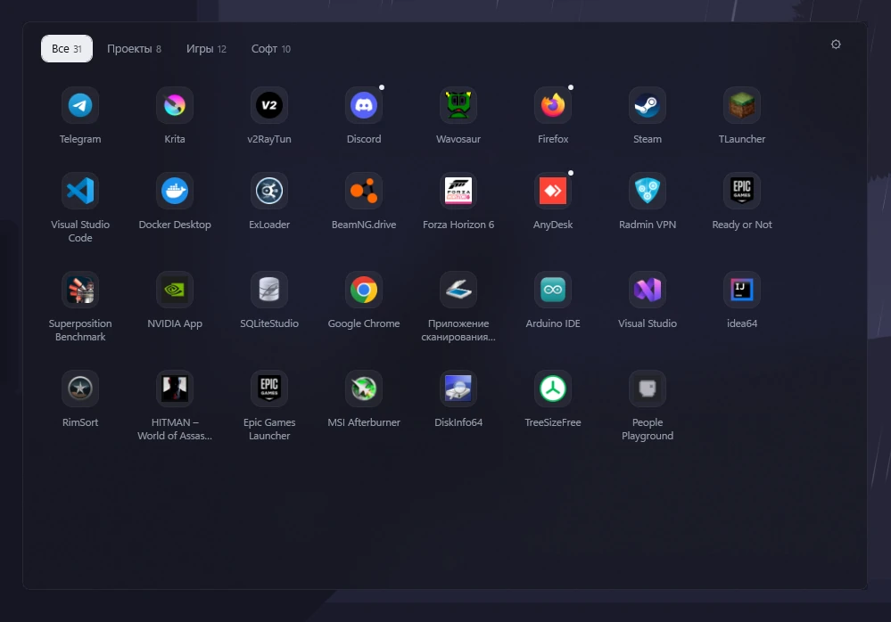

# VLAP — виртуальная панель

VLAP (Virtual Launch Assistant Panel) — панель быстрого доступа к приложениям, папкам и наборам
команд. Вызывается горячей клавишей, работает поверх рабочего стола и остаётся в фоне.
Windows 10/11 x64, один `.exe` без установки.

- Горячая клавиша `Alt + Space` по умолчанию.
- Поиск при наборе: поля ввода нет, список фильтруется на лету.
- Перетаскивание `.exe`, ярлыков, `.url`, `.py` и папок в сетку; порядок меняется перетаскиванием.
- Категории-вкладки и наборы для запуска группы приложений одной командой.
- Частота запусков, папки с автоудалением, две темы, масштаб 90–160 %.
- Значок в трее, автозапуск и резервное копирование настроек.

## Быстрая установка

1. Скачать `VLAP.exe` из [Releases](../../releases/latest) и запустить — установка не нужна.
2. При первом запуске автозапуск включается сам, панель открывается вместе с настройками.
3. Нажать `Alt + Space` — панель появляется поверх других окон.
4. Перетащить в неё `.exe`, ярлык или папку — плитка добавится сразу.



## Управление

| Действие | Результат |
|---|---|
| Горячая клавиша (`Alt + Space`) | Показать или скрыть панель |
| ЛКМ по плитке | Запустить приложение |
| `Ctrl` + ЛКМ | Запустить новый экземпляр принудительно |
| `Alt` + ЛКМ | Запустить, оставив панель открытой |
| ПКМ по плитке | Изменить, открыть папку, запуск от администратора, убрать |
| `Esc` | Закрыть панель или сбросить поиск |
| Двойной клик по значку в трее | Открыть панель |

## HTTP API

Локальный JSON API на `http://127.0.0.1:49521/` для внешних скриптов и агентов. Доступен только
с этой машины и работает в фоне: панель не открывается, фокус не перехватывается.

По умолчанию сервер выключен. Включается в настройках: «Поведение» → «HTTP-сервер», применяется
сразу. Если порт занят другой программой, сервер не запустится, а настройка останется выключенной.

| Метод | Путь | Назначение |
|---|---|---|
| `GET` | `/apps` | приложения и папки: `id`, `name`, `type`, `resource`, `categories`, `running` |
| `GET` | `/presets` | наборы с идентификаторами приложений |
| `GET` | `/state` | видимость панели, число приложений и наборов |
| `POST` | `/launch` | `{"id": "..."}` — запустить приложение |
| `POST` | `/presets/run` | `{"name": "..."}` — запустить набор |
| `POST` | `/presets` | `{"name": "...", "apps": ["id", ...]}` — создать или заменить набор |
| `DELETE` | `/presets/{name}` | удалить набор; приложения сохраняются |

Идентификатор приложения постоянный, поэтому переименование не ломает наборы и внешние ссылки.

## Данные и настройки

Настройки лежат в `%APPDATA%\VLAP\`: `settings.json` — приложения и параметры, `settings.bak.json` —
предыдущее сохранение, `settings.snapshot.json` — бэкап для отката, `log.txt` — журнал.

В разделе «Данные» — экспорт и импорт настроек, откат к внутреннему бэкапу и сброс к базовым
значениям.

## Сборка

Нужен [.NET 10 SDK](https://dotnet.microsoft.com/download).

```bat
dotnet publish -c Release -r win-x64 --self-contained true ^
  -p:PublishSingleFile=true -p:IncludeNativeLibrariesForSelfExtract=true -o publish
```

Результат — `publish\VLAP.exe` (~150 МБ).

Релиз подписывается самоподписанным сертификатом `CN=VLAP Self-Signed`.